<!-- ═════════════════════════════ HEADER ═════════════════════════════ -->
<p align="center">
  
</p>

<p align="center">
  <a href="https://github.com/zain-zameer">
    
  </a>
</p>

<p align="center">
  
  
  
</p>

<!-- ═════════════════════════════ SOCIALS ═════════════════════════════ -->
<p align="center">
  <a href="https://www.linkedin.com/in/muhammadzain-zameer"></a>
  <a href="mailto:officialmuhammadzain45@gmail.com"></a>
  <a href="https://www.youtube.com/@unfiltered.a.i"></a>
  <a href="https://medium.com/@aiunfiltered"></a>
  <a href="https://dev.to/aiunfiltered"></a>
  <br/>
  <a href="https://x.com/_unfilteredai"></a>
  <a href="https://www.instagram.com/a.i.unfiltered/"></a>
  <a href="https://www.tiktok.com/@a.i.unfiltered"></a>
  <a href="https://www.skool.com/@muhammadzain-zameer-8664"></a>
</p>


<!-- ═════════════════════════════ ABOUT ═════════════════════════════ -->
## `whoami`

> *Shifted a button 2px left and triggered a cascade of neural curiosity.*
> *Bootstrapped from pixels to pipelines — blending **full-stack logic** with **computer vision dreams**, stitched together by **transformers whispering in matrix math**.*

```python
class ZainZameer:
    def __init__(self):
        self.title      = "Happy Guy"
        self.now        = ["Software Engineering Team Lead @ Ellington Technologies",
                           "Full Stack AI Engineer @ Ellington Technologies"]
        self.building   = "Ezra — a multi-tenant AI marketing assistant"
        self.based_in   = "Islamabad, Pakistan"
        self.studying   = "BSc Computer Science @ Iqra University (2023 – 2027)"
        self.speaks     = ["Python", "JavaScript", "C++", "Java", "R", "SQL"]
        self.thinks_in  = ["LLM Agents", "RAG", "MCP", "PyTorch", "OpenCV", "YOLOv8"]
        self.fuel       = "caffeine -> deployments"

    def philosophy(self) -> str:
        return ("I build intelligent systems not just because they're needed, "
                "but because they *could exist*.")

    def debug(self, reality):
        return reality.layers(dense=True, otherwise=True)


me = ZainZameer()
me.philosophy()
```


<!-- ═════════════════════════════ TECH ═════════════════════════════ -->
## Arsenal

<div align="center">

### AI · ML · Data


### Languages


### Frontend & Apps


### Backend & Databases


### DevOps & Tooling


</div>


<!-- ═════════════════════════════ EXPERIENCE ═════════════════════════════ -->
## The Journey

### Right Now — Ellington Technologies

**Software Engineering Team Lead** · *Oct 2026 – Present*
**Full Stack AI Engineer** · *Mar 2026 – Present* · Remote (US)

> Designed and built **Ezra** — the company's flagship AI marketing assistant — as a production multi-tenant SaaS.
> Owned it end to end: **architecture, backend, frontend and deployment.**

| Area | What I built into Ezra |
|:---|:---|
| **Agent engine** | Async FastAPI core orchestrating the Claude model family with fallback chains, streaming tool-use events, extended thinking, prompt caching, loop detection and graceful degradation during model/API outages |
| **3,000+ integrations** | Dynamic tool layer on Composio + MCP with per-user OAuth and multi-account support (Gmail, Slack, Notion, Calendar…) |
| **Long-term memory** | RAG with OpenAI embeddings + pgvector (HNSW, cosine) for time-aware recall of past conversations |
| **Multi-tenancy** | Supabase Row-Level Security per org, Fernet encryption at rest with key rotation, Stripe credit billing with idempotent webhooks and token-level metering |
| **Re-architecture** | Moved the product off a third-party agent framework onto a custom platform to unlock account isolation, multi-customer scaling and per-org usage tracking |
| **Power features** | Scheduled tasks, HTML → PDF / Word / image generation (headless Chromium via Playwright), shareable conversation links, chat organization |
| **Frontend** | React app with real-time streaming chat, file artifact previews, integrations dashboard, billing UI, team management and a dual-theme marketing site |

<p>
  
  
  
  
  
  
  
  
</p>

**Recognition for Excellence** &nbsp;·&nbsp; **Certificate of Appreciation — Rapid Execution & Problem-Solving**

### The Full Timeline

<div align="center">

| Period | Role | Where | Highlight |
|:---:|:---|:---|:---|
| `2026·10 → now` | **Software Engineering Team Lead** | **Ellington Technologies** | Leading the team behind Ezra |
| `2026·03 → now` | **Full Stack AI Engineer** | **Ellington Technologies** | Built Ezra from the ground up |
| `2025·12 → 26·02` | **Founding AI Engineer** | HeySupport.AI | Sole AI engineer on a Shopify support SaaS |
| `2025·09 → 26·04` | Full Stack Engineer | Upwork | 100% Job Success Score, 5-star feedback |
| `2025·06 → 25·08` | Data Scientist (Intern) | 10Pearls | AQI forecasting at R² = 0.91 |
| `2025·06 → 25·08` | Dev Fellow | Dev Weekends | React + Tailwind apprenticeship |
| `2024·11 → 25·02` | Computer Vision Engineer | Marquette University | YOLOv8 bee-behavior detection |
| `2024·10 → 25·03` | Data Analyst | Marquette University | 170K+ observation behavioral analytics |
| `2024·10 → 25·01` | Teacher Assistant | Iqra University | PF, OOP & DSA labs |
| `2024·08 → 24·09` | ML Engineer (Intern) | CodexCue | Python ML pipelines |
| `2024·05 → 24·12` | R & Bioinformatics Tutor | Freelance | RNA-Seq with DESeq2 |
| `2023·10 → 24·10` | Global Campus Student | GitHub | |
| `2023·10 → 23·11` | Python Developer Intern | CodSoft | PyQt desktop apps |

</div>

<details>
<summary><b>Deep dives</b> (click to expand)</summary>
<br/>

**HeySupport.AI — Founding AI Engineer**
- Sole AI engineer, working directly with the founders on a production multi-tenant eCommerce support SaaS
- Shopify-embedded LLM chatbot answering in real time from merchant knowledge bases
- Client / Agent / Admin dashboards with RBAC, live chat telemetry and WebSocket escalation
- Tenant-isolated architecture with per-store bot instances plus subscriptions & billing
- Shopify Admin REST integration for SKU-level variants, inventory and authenticated order lookups

**Upwork — Full Stack Engineer**
- End-to-end web and AI apps for eCommerce and SaaS clients
- Secure APIs with authentication and role-based access control
- **100% Job Success Score** with consistent 5-star reviews

**10Pearls — Data Scientist**
- Real-time AQI + weather ingestion pipeline (AirVisual API) for Islamabad
- Temporal and lag features; compared Linear Regression, Random Forest and XGBoost
- Lag-based model hit **R² = 0.91**, beating the ensembles
- Shipped as a React + Tailwind app on Vercel with automated CI/CD retraining

**Marquette University — CV Engineer & Data Analyst**
- YOLOv8 Nano model classifying fanning vs. non-fanning bees from raw hive footage; annotation in CVAT
- Django web app returning live detection counts from uploaded images
- R / tidyverse analytics over **170,000+** observations with a custom frame-based temporal matching algorithm

**Freelance — R & Bioinformatics Tutor**
- Taught RNA-Seq workflows (QC, PCA, heatmaps, DESeq2, volcano plots) and supervised ML in R — during my 3rd semester

</details>

<details>
<summary><b>Education</b> (click to expand)</summary>
<br/>

| School | Program | Years |
|:---|:---|:---:|
| **Iqra University** | BSc, Computer Science | 2023 – 2027 |
| Jamia Millia Govt Degree College | Intermediate, Computer Science | 2021 – 2022 |
| Maple Grammar School | Matriculation, Computer Science | 2019 – 2020 |

</details>

<details>
<summary><b>Certifications</b> (click to expand)</summary>
<br/>

<p>
  
  
  
  
</p>

</details>

<details>
<summary><b>Writing</b> (click to expand)</summary>
<br/>

- **[How I Built NeuroShell — An AI-Powered Terminal That Understands You](https://medium.com/@aiunfiltered)**

</details>


<!-- ═════════════════════════════ STATS ═════════════════════════════ -->
## By the Numbers

<div align="center">

<!-- These cards are generated by .github/workflows/profile.yml and committed into this repo -->









</div>

<!-- ═════════════════════════════ SNAKE ═════════════════════════════ -->
<div align="center">

<picture>
  <source media="(prefers-color-scheme: dark)" srcset="https://raw.githubusercontent.com/zain-zameer/zain-zameer/output/github-snake-dark.svg" />
  <source media="(prefers-color-scheme: light)" srcset="https://raw.githubusercontent.com/zain-zameer/zain-zameer/output/github-snake.svg" />
  
</picture>

</div>


<!-- ═════════════════════════════ FUN ═════════════════════════════ -->
## Side Quests

<div align="center">

| Fuel | Method | Mission |
|:---:|:---:|:---:|
| **Caffeine-fueled** deployments | Debugging reality through layers — **dense and otherwise** | Blurring the line between **imagination and execution** |

<br/>


</div>

<!-- ═════════════════════════════ FOOTER ═════════════════════════════ -->
<p align="center">
  
</p>
